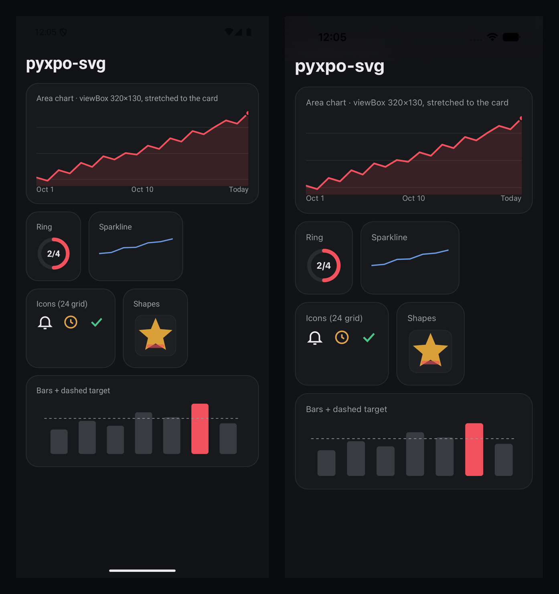
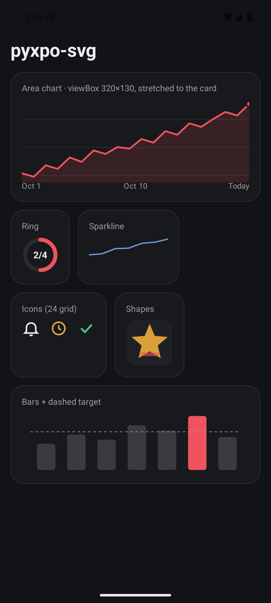
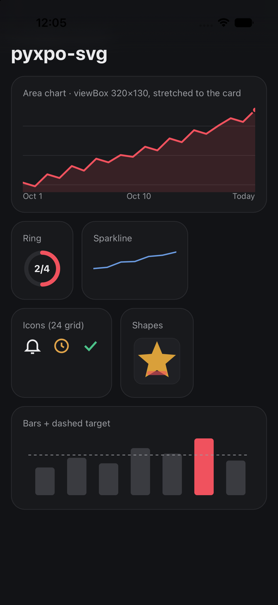

# pyxpo-svg

[](https://github.com/pyxpo/pyxpo-svg/actions/workflows/ci.yml) [](https://pypi.org/project/pyxpo-svg/) [](https://pypi.org/project/pyxpo-svg/) [](LICENSE)

Vector drawing for [pyxpo](https://github.com/pyxpo/pyxpo) apps written in Python: paths, lines, circles, rectangles,
polygons, groups and text, laid out with an SVG `viewBox`. Use it for charts, progress rings, sparklines and icons.
The tree is built in Python, flattened to a short list of draw steps, and drawn natively: Android `Canvas`,
iOS Core Graphics, and a real `<svg>` element on the web. There is no WebView and no image decoding.

<p align="center">
  
</p>

```python
from pyxpo_svg import Circle, Svg, Text

Svg(
    Circle(28, 28, 23, fill="none", stroke="#2a2b2f", stroke_width=6),
    Circle(28, 28, 23, fill="none", stroke="#f0525e", stroke_width=6, stroke_linecap="round",
           stroke_dasharray=[72, 145], transform="rotate(-90 28 28)"),
    Text("2/4", 28, 33, text_anchor="middle", font_size=14, font_weight="bold", fill="#ececee"),
    width=56, height=56,
)
```

## Features

- **Shapes:** `Path`, `Line`, `Circle`, `Ellipse`, `Rect` (with rounded corners), `Polyline`, `Polygon`, `Text`.
- **Full path data:** every SVG path command, absolute and relative, including arcs (`A`) and smooth curves (`S`, `T`).
- **Groups:** `G` passes paint to its children, composes `transform` and multiplies `opacity`.
- **viewBox:** draw in your own units and let the view scale them, with `preserve_aspect_ratio` (`meet`, `slice`
  or `none`).
- **Paint:** fill, stroke, opacity, even-odd fill rule, line caps and joins, miter limit, dashes with an offset.
- **Transforms:** `translate`, `scale`, `rotate` (with a centre), `skewX`, `skewY`, `matrix`.
- **`currentColor`:** set `color` on the `Svg` once and reuse an icon in any color.
- **Fast:** the tree is flattened in Python. The native side only replays the draw steps.
- **Typed:** ships `py.typed`.

## Contents

| If you are... | Start here |
| --- | --- |
| Drawing your first shape | [Quick start](#quick-start) |
| Building a chart | [Recipe: area chart](#recipe-area-chart) · [Recipe: bar chart](#recipe-bar-chart) |
| Making a progress ring or an icon | [Recipe: progress ring](#recipe-progress-ring) · [Recipe: icons](#recipe-icons) |
| Sizing the drawing | [Size and viewBox](#size-and-viewbox) |
| Exact signatures | [API reference](#api-reference) · [Errors](#errors) |
| Stuck | [Testing](#testing) · [Troubleshooting](#troubleshooting) · [FAQ](#faq) |

## Platform support

| Target | What works |
| --- | --- |
| Android, API 24+ | Everything. Font weights other than normal and bold need API 28+. |
| iOS 15+ | Everything. |
| Web page | Everything, as an inline `<svg>` element. |
| Desktop window | Not supported yet. |

Requires Python 3.9+ and `pyxpo>=0.1.0a3`. It needs no permissions.

## Install

```sh
pip install pyxpo-svg
```

```toml
[tool.pyxpo]
modules = ["svg"]
```

Rebuild the app so the native view is linked.

## Quick start

```python
from pyxpo import View
from pyxpo_svg import Circle, Rect, Svg


def Index():
    return View(
        Svg(
            Rect(0, 0, 100, 60, rx=12, fill="#18191c"),
            Circle(30, 30, 14, fill="#f0525e"),
            width=100, height=60,
        ),
        style={"flex": 1, "alignItems": "center", "justifyContent": "center"},
    )
```

Without a `view_box`, one user unit is one density-independent pixel (dp on Android, pt on iOS, CSS px on the web).

<p align="center">
  
  
</p>

## Size and viewBox

`width` and `height` size the view, like `style` width and height. They take numbers or strings such as `"100%"`.
A `style` passed as well wins over them.

`view_box="x y w h"` (or a 4-tuple) maps user units onto the view. `preserve_aspect_ratio` decides how:

| Value | Result |
| --- | --- |
| `"xMidYMid meet"` (default) | Scale evenly so all of the box is visible, centred. |
| `"xMinYMin meet"`, `"xMaxYMax meet"` and the other alignments | Same, aligned to that corner or edge. |
| `"xMidYMid slice"` | Scale evenly so the box fills the view. The overflow is clipped. |
| `"none"` | Stretch each axis on its own. Good for charts that fill a card. |

The drawing is always clipped to the view.

## Recipe: area chart

Draw in a fixed box and stretch it to the card width with `preserve_aspect_ratio="none"`. Text is stretched too, so
keep the box close to the real aspect ratio.

```python
from pyxpo_svg import Circle, G, Line, Path, Svg, Text

VIEWS = [42, 38, 51, 47, 60, 55, 68, 64, 72, 70, 81, 77, 90, 86, 99, 95, 104, 112, 108, 121]


def area(values, w, h, pad=8):
    hi, lo = max(values), min(values)
    step = w / (len(values) - 1)
    pts = [(i * step, pad + (hi - v) / ((hi - lo) or 1) * (h - 2 * pad)) for i, v in enumerate(values)]
    line = "M" + " L".join("%.1f %.1f" % p for p in pts)
    return line, line + " L%.1f %.1f L0 %.1f Z" % (w, h, h), pts[-1]


line, fill, end = area(VIEWS, 320, 120)
chart = Svg(
    G(*[Line(0, y, 320, y) for y in (30, 70, 110)], stroke="#2a2b2f"),
    Path(fill, fill="#f0525e", fill_opacity=0.14),
    Path(line, fill="none", stroke="#f0525e", stroke_width=2.5, stroke_linejoin="round", stroke_linecap="round"),
    Circle(end[0], end[1], 4, fill="#f0525e"),
    G(Text("Oct 1", 0, 129), Text("Today", 320, 129, text_anchor="end"), fill="#9a9ca1", font_size=11),
    view_box="0 0 320 132", preserve_aspect_ratio="none", style={"height": 140},
)
```

A sparkline is the same `line` path in a small `Svg(width=120, height=32)` with no box.

## Recipe: bar chart

```python
from pyxpo_svg import G, Line, Rect, Svg

bars = (40, 54, 46, 68, 60, 82, 50)
Svg(
    G(*[Rect(10 + i * 46, 88 - h, 28, h, rx=4) for i, h in enumerate(bars)], fill="#3a3b40"),
    Rect(240, 6, 28, 82, rx=4, fill="#f0525e"),                    # highlight today
    Line(0, 30, 320, 30, stroke="#9a9ca1", stroke_dasharray="4 4"),  # target
    view_box="0 0 320 92", style={"height": 92},
)
```

## Recipe: progress ring

A circle's outline starts at 3 o'clock and runs clockwise. Rotate it by -90 degrees to start at 12 o'clock. The
circumference is `2 * pi * r`; dash that much times the progress, then a gap of the full circumference.

```python
import math

from pyxpo_svg import Circle, Svg


def ring(progress, size=56, width=6, color="#f0525e"):
    c = size / 2
    r = c - width / 2 - 2
    full = 2 * math.pi * r
    return Svg(
        Circle(c, c, r, fill="none", stroke="#2a2b2f", stroke_width=width),
        Circle(c, c, r, fill="none", stroke=color, stroke_width=width, stroke_linecap="round",
               stroke_dasharray=[full * progress, full], transform="rotate(-90 %g %g)" % (c, c)),
        width=size, height=size,
    )
```

## Recipe: icons

Paste the path data from a 24 x 24 icon set and use `currentColor`, so the caller picks the color.

```python
from pyxpo_svg import G, Path, Svg


def BellIcon(color="#ececee", size=24):
    return Svg(
        G(Path("M6 16V11a6 6 0 0 1 12 0v5l2 2H4z"), Path("M10 21h4"),
          fill="none", stroke="currentColor", stroke_width=2),
        color=color, view_box="0 0 24 24", width=size, height=size,
    )
```

## Paint attributes

Set them on any shape or on a `G`. Children inherit them, as in SVG.

| Attribute | Values | Default |
| --- | --- | --- |
| `fill` | Color, `"none"` or `"currentColor"` | `"#000000"` |
| `fill_opacity` | 0 to 1 | 1 |
| `fill_rule` | `"nonzero"`, `"evenodd"` | `"nonzero"` |
| `stroke` | Color, `"none"` or `"currentColor"` | none |
| `stroke_width` | Number | 1 |
| `stroke_opacity` | 0 to 1 | 1 |
| `stroke_linecap` | `"butt"`, `"round"`, `"square"` | `"butt"` |
| `stroke_linejoin` | `"miter"`, `"round"`, `"bevel"` | `"miter"` |
| `stroke_miterlimit` | Number | 4 |
| `stroke_dasharray` | `"4 4"` or a list of numbers | none |
| `stroke_dashoffset` | Number | 0 |
| `font_size`, `font_weight`, `font_family`, `text_anchor` | Text only | 16, 400, system font, `"start"` |
| `opacity` | 0 to 1, not inherited, multiplied down the tree | 1 |
| `transform` | SVG transform list, not inherited, composed down the tree | none |

Colors are `"#rgb"`, `"#rrggbb"`, `"#rrggbbaa"`, `"rgb(...)"`, `"rgba(...)"`, named colors and `"transparent"`.
An odd dash list is repeated, as in SVG.

## API reference

### `Svg(*children, width=None, height=None, view_box=None, preserve_aspect_ratio="xMidYMid meet", color="#000000", style=None, **props)`

The view. Children are shapes, groups, lists of them, or `None` (skipped). `color` is what `"currentColor"` means.
Other props, such as `key` or `accessibility_label`, go to the view.

### Shapes

| Function | Draws |
| --- | --- |
| `Path(d, **paint)` | SVG path data. |
| `Line(x1, y1, x2, y2, **paint)` | A line. Give it a `stroke`. |
| `Circle(cx, cy, r, **paint)` | A circle. |
| `Ellipse(cx, cy, rx, ry, **paint)` | An ellipse. |
| `Rect(x, y, width, height, rx=None, ry=None, **paint)` | A rectangle. One radius sets both. |
| `Polyline(points, **paint)` | An open line. `points` is `"0,10 20,5"`, `[(0, 10), (20, 5)]` or `[0, 10, 20, 5]`. |
| `Polygon(points, **paint)` | A closed shape through `points`. |
| `Text(text, x, y, **paint)` | One line of text. `y` is the baseline. Filled only. |
| `G(*children, **paint)` | A group. |

### Helpers

| Function | Returns |
| --- | --- |
| `parse_path(d)` | Flat list of draw steps, with arcs turned into curves. |
| `parse_transform(value)` | 6-tuple matrix `(a, b, c, d, e, f)`. |

## Errors

| Error | When |
| --- | --- |
| `ValueError: path data must start with M` | Path data starts with another command. |
| `ValueError` naming the attribute | A bad number, a negative radius or size, an unknown cap, join, anchor or alignment, or a bad color. |
| `ValueError: view_box needs x, y and a positive width and height, got ...` | `view_box` does not have 4 numbers, or the size is 0. |
| `TypeError: Circle() got an unexpected keyword argument 'x'` | An attribute that the shape does not take. |

Errors are raised in Python, when the tree is built, never on the device.

## Testing

The builders are plain Python. Test them without a device:

```python
from pyxpo_svg import Circle, G, parse_path


def test_group_paint_is_inherited():
    node = G(Circle(10, 10, 5), fill="#ff0000")
    assert node.children[0].attrs.get("fill") is None   # resolved when the Svg is flattened
    assert node.attrs["fill"] == "#ff0000"


def test_relative_path():
    assert parse_path("M10 10 l5 0")[:6] == [0, 10, 10, 1, 15, 10]
```

## Troubleshooting

| Symptom | Cause and fix |
| --- | --- |
| Nothing is drawn | Give the `Svg` a size (`width` and `height`, or a `style`). A view with no size draws nothing. |
| The view shows "unknown view PxSvg" | Add `"svg"` to `modules` and rebuild. |
| A line is not visible | Lines have no fill. Set `stroke`. |
| Text looks stretched | `preserve_aspect_ratio="none"` stretches text too. Use a box close to the view's aspect ratio. |
| A ring starts at 3 o'clock | Add `transform="rotate(-90 cx cy)"`. |
| Fill and stroke overlap at a faded group | Group `opacity` fades each child on its own. Fade the colors instead. |

## FAQ

**Can it load an `.svg` file?** No. Build the tree in Python. For icons, copy the path data.

**Gradients, clip paths, masks, images, filters?** Not in this version.

**Is it interactive?** The view takes the normal pyxpo touch props. Shapes have no own touch events; wrap the `Svg`
in a `Pressable`.

**Does it redraw on every render?** Only when the flattened draw steps change.

## License

MIT. See [LICENSE](LICENSE).
